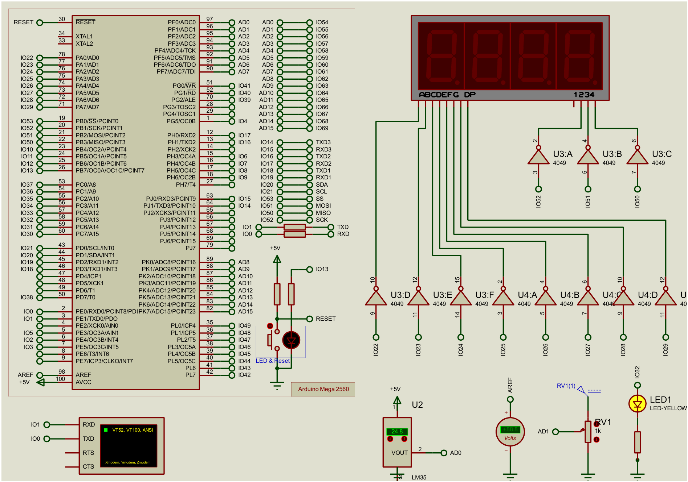

# **Digital thermometer with an adjustable alarm**

```
Arduino project no. 5: LM35 and 7-segment display
Written by RHIBA Zakaria, Zakpy Academy
```

*In this project we measure the temperature with an LM35 sensor and show it on a 7-segment display to 0.1 °C (for example 24.8). A potentiometer sets an alarm temperature between 0 and 40 °C. When the temperature goes above the alarm, an LED starts blinking.*

*The project looks simple, but it covers important ideas: the ADC, multiplexing a display, the microcontroller registers, timers and interrupts.*

## **The project documents**

___

| Document | Content |
|---|---|
| [Project sheet](https://github.com/zakariarhiba/ARDUINO-PROJECTS/blob/main/Digital_Thermometer_LM35/docs/Fiche_projet.pdf) | the description, the Proteus schematic, the steps and the appendices (French) |
| [Course notes](https://github.com/zakariarhiba/ARDUINO-PROJECTS/blob/main/Digital_Thermometer_LM35/docs/Support_de_cours.pdf) | all the explanations, common mistakes and solved exercises (French) |
| [LM35 datasheet](https://github.com/zakariarhiba/ARDUINO-PROJECTS/blob/main/Digital_Thermometer_LM35/docs/datasheet_capteur_LM35.pdf) | the sensor documentation |

## **What you will learn**

___

- Read a voltage with the ADC and pick the right reference (1.1 V).
- Encode the digits of a 7-segment display in one byte.
- Write 8 pins at once with the `PORTA` register.
- Show several digits with multiplexing.
- Set up a timer and use an interrupt.

## **What you need**

___

- An Arduino Mega 2560 board
- An LM35 temperature sensor
- A 4-digit 7-segment display (12 pins, for example a common cathode 5641AS)
- A 1 kΩ potentiometer and a 3.3 kΩ resistor
- An LED and a 220 Ω resistor
- 8 1 kΩ resistors (one per segment)

## **Wiring**

___



| Part | Arduino pin |
|---|---|
| LM35 (Vout output) | A0 |
| Potentiometer (wiper) | A1 |
| Segments A, B, C, D, E, F, G, DP | 22 to 29 (PORTA) |
| Tens, units, tenths digits | 52, 51, 50 |
| Alarm LED | 32 |

> Pins 22 to 29 form PORTA of the ATmega2560. So we can write the 8 segments of a digit in one line: `PORTA = 0x5B;` shows a 2.

## **Measuring the temperature**

___

The LM35 gives 10 mV per degree. We use the internal 1.1 V reference of the ADC: one step is then 1.1 V / 1024 = 1.07 mV, about 0.1 °C.

```C++
analogReference(INTERNAL1V1);
```

The calculation `N × 1100 / 1024` gives millivolts, and since 1 mV = 0.1 °C, it is directly the temperature in tenths of a degree (248 = 24.8 °C). We use a `long` because 1023 × 1100 is too big for an `int`:

```C++
int mesureTemp() {
  long N = analogRead(LM35_pin);
  return (int)((N * 1100L) / 1024L);
}
```

## **Showing it on the 7-segment display**

___

Each segment is one bit (bit 0 = A … bit 7 = DP), and we add the decimal point with `| 0x80`:

```C++
byte tabDigit[] = {0x3F, 0x06, 0x5B, 0x4F, 0x66, 0x6D, 0x7D, 0x07, 0x7F, 0x6F};
```

The segments are shared between the digits, so we light only one digit at a time, 5 ms each: this is multiplexing. Timer 1 handles it in an interrupt every 5 ms (prescaler 64, `OCR1A = 1249`):

```C++
ISR(TIMER1_COMPA_vect) {
  digitalWrite(DIG_D2, HIGH);              // on éteint tout
  digitalWrite(DIG_D3, HIGH);
  digitalWrite(DIG_D4, HIGH);
  PORTA = affichage[digitCourant];         // les segments du chiffre
  digitalWrite(pinDigits[digitCourant], LOW);   // on allume ce chiffre
  digitCourant++;
  if (digitCourant >= 3) digitCourant = 0;
}
```

## **The alarm**

___

The potentiometer becomes a temperature between 0 and 40.0 °C:

```C++
int mesureTrigger() {
  return map(analogRead(POT), 0, 1023, 0, 400);
}
```

Timer 3 makes the LED blink every 0.5 s (prescaler 256, `OCR3A = 31249`) when the temperature is above the alarm. The `loop()` only measures and decides:

```C++
alarme = (temp > temp_trigger);
```

## **The project steps**

___

The code of each step is in the [steps](https://github.com/zakariarhiba/ARDUINO-PROJECTS/tree/main/Digital_Thermometer_LM35/steps) folder, with the same numbers as the project sheet:

- `Etape1_Lire_Temperature`: read the LM35 and test the display with 88.8
- `Etape2_Affichage_Timer1`: show the temperature with Timer 1
- Step 3 is the wiring on the real board, with the same code as step 2
- `Etape4_Alarme_Potentiometre`: set the alarm with the potentiometer, the LED turns on
- `Etape5_Alarme_Clignotante_Timer3`: the LED blinks with Timer 3

## **Testing without hardware on Wokwi**

___

Create a new Arduino Mega project on [wokwi.com](https://wokwi.com), paste `wokwi/sketch.ino` in the code tab and `wokwi/diagram.json` in the diagram tab, then start the simulation. Wokwi has no LM35, so a potentiometer on A0 plays the temperature.

> On the real board, if your display is common anode (for example a 5641BS), you must invert the segments (`PORTA = ~affichage[...]`) and the digits (`HIGH` to select, `LOW` to turn off).

## **The full code**

___

The comments and messages in the code are in French, like the `.ino` file you download.

```C++
/*********************************************************************
 *  Thermomètre numérique avec alarme - Arduino Mega 2560 (16 MHz)
 *  LM35 + afficheur 7 segments (Timer 1) + alarme réglable (Timer 3)
 *  Written by RHIBA Zakaria - Zakpy Academy
 *********************************************************************/
#define LM35_pin A0      // capteur LM35
#define POT      A1      // potentiomètre du seuil
#define LED      32      // LED d'alarme
#define DIG_D2   52      // afficheur des dizaines
#define DIG_D3   51      // afficheur des unités (+ point)
#define DIG_D4   50      // afficheur des dixièmes

// Codes 0..9, 1 = segment allumé (cathode commune, ou anode commune + 4049)
byte tabDigit[] = {0x3F, 0x06, 0x5B, 0x4F, 0x66, 0x6D, 0x7D, 0x07, 0x7F, 0x6F};
const byte pinDigits[3] = {DIG_D2, DIG_D3, DIG_D4};

volatile byte affichage[3];          // les 3 codes à afficher
volatile byte digitCourant = 0;      // afficheur allumé en ce moment
volatile bool alarme = false;        // décidée par loop(), lue par Timer 3

int temp;                            // température en dixièmes (248 = 24,8 °C)
int temp_trigger;                    // seuil en dixièmes (0..400)

void prepareAffichage(int number);
int  mesureTemp();
int  mesureTrigger();
void initTimer1();
void initTimer3();

void setup() {
  Serial.begin(9600);

  pinMode(DIG_D2, OUTPUT);  digitalWrite(DIG_D2, HIGH);   // HIGH = éteint
  pinMode(DIG_D3, OUTPUT);  digitalWrite(DIG_D3, HIGH);
  pinMode(DIG_D4, OUTPUT);  digitalWrite(DIG_D4, HIGH);
  pinMode(LED, OUTPUT);     digitalWrite(LED, LOW);

  analogReference(INTERNAL1V1);      // 1 pas = 1,07 mV ≈ 0,1 °C
  analogRead(LM35_pin);              // 1re lecture ignorée

  DDRA  = 0xFF;                      // broches 22..29 en sortie
  PORTA = 0x00;

  initTimer1();                      // multiplexage toutes les 5 ms
  initTimer3();                      // clignotement toutes les 0,5 s

  prepareAffichage(888);             // test des segments : 88.8
  delay(3000);
}

void loop() {
  temp         = mesureTemp();
  temp_trigger = mesureTrigger();
  alarme       = (temp > temp_trigger);   // loop() décide, les timers agissent

  prepareAffichage(temp);

  Serial.print("Temp = ");
  Serial.print(temp / 10);  Serial.print(".");  Serial.print(temp % 10);
  Serial.print(" C  |  Seuil = ");
  Serial.print(temp_trigger / 10);  Serial.print(".");  Serial.print(temp_trigger % 10);
  Serial.println(alarme ? " C  -> ALARME" : " C");

  delay(500);
}

// Température en dixièmes : N x 1100 / 1024 = mV = dixièmes de °C
int mesureTemp() {
  long N = analogRead(LM35_pin);           // long : 1023 x 1100 dépasse un int
  return (int)((N * 1100L) / 1024L);
}

// Seuil en dixièmes : 0..1023 -> 0..400 (0,0 à 40,0 °C)
int mesureTrigger() {
  return map(analogRead(POT), 0, 1023, 0, 400);
}

// Découpe la valeur en 3 chiffres et prépare les codes
void prepareAffichage(int number) {
  if (number > 999) number = 999;          // 3 digits : 99,9 max
  if (number < 0)   number = 0;

  int dizaine = number / 100;
  int unite   = (number / 10) % 10;
  int dixieme = number % 10;

  if (dizaine == 0) affichage[0] = 0x00;   // pas de zéro inutile
  else              affichage[0] = tabDigit[dizaine];
  affichage[1] = tabDigit[unite] | 0x80;   // point décimal (bit 7)
  affichage[2] = tabDigit[dixieme];
}

// Timer 1 : CTC, prescaler 64, 1250 ticks de 4 us = 5 ms
void initTimer1() {
  noInterrupts();
  TCCR1A = 0;
  TCCR1B = 0;
  TCNT1  = 0;
  OCR1A  = 1249;
  TCCR1B |= (1 << WGM12);                  // mode CTC
  TCCR1B |= (1 << CS11) | (1 << CS10);     // prescaler 64
  TIMSK1 |= (1 << OCIE1A);                 // autorise l'interruption
  interrupts();
}

// Timer 3 : CTC, prescaler 256, 31250 ticks de 16 us = 0,5 s
void initTimer3() {
  noInterrupts();
  TCCR3A = 0;
  TCCR3B = 0;
  TCNT3  = 0;
  OCR3A  = 31249;
  TCCR3B |= (1 << WGM32);                  // mode CTC
  TCCR3B |= (1 << CS32);                   // prescaler 256
  TIMSK3 |= (1 << OCIE3A);
  interrupts();
}

// Multiplexage : un afficheur à chaque appel (toutes les 5 ms)
ISR(TIMER1_COMPA_vect) {
  digitalWrite(DIG_D2, HIGH);              // 1) tout éteindre
  digitalWrite(DIG_D3, HIGH);
  digitalWrite(DIG_D4, HIGH);

  PORTA = affichage[digitCourant];         // 2) segments du chiffre
  digitalWrite(pinDigits[digitCourant], LOW);   // 3) allumer cet afficheur

  digitCourant++;                          // 4) le suivant au prochain appel
  if (digitCourant >= 3) digitCourant = 0;
}

// Clignotement : bascule la LED toutes les 0,5 s si alarme
ISR(TIMER3_COMPA_vect) {
  if (alarme) digitalWrite(LED, !digitalRead(LED));
  else        digitalWrite(LED, LOW);
}
```

## **Going further**

___

- Replace the LED with a buzzer for a real sound alarm.
- Add hysteresis so the alarm does not keep switching on and off around the limit.
- Keep the limit in memory (EEPROM) even after a power cut.
- Send the temperature to your phone, a first brick for the King House smart home project.
